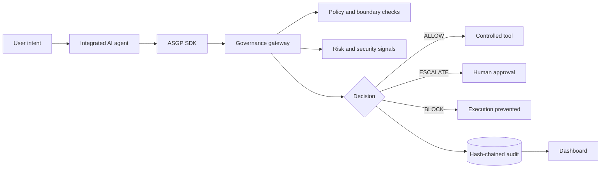
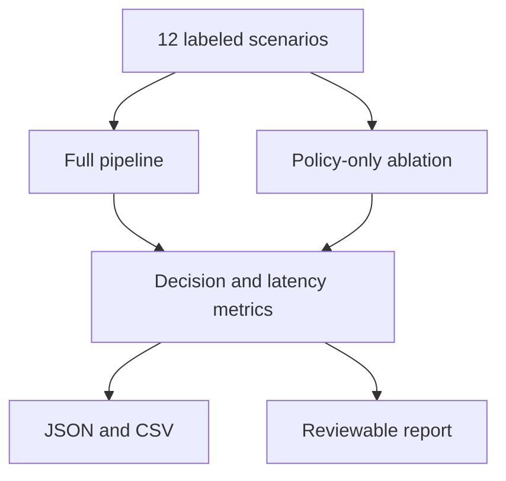

# Thesis figure sources

The following Mermaid sources can be exported as SVG for the thesis.

## System boundary

## Evaluation design

Do not present the generated rates without the caption: “Results on the controlled ASGP lab dataset; not an estimate of real-world prevalence or generalization.”
