**ASGP**

Agent Security Governance Platform

Software Analysis & Design Documentation

Requirements · Use Cases · Architecture · Data Model · Behavioral Diagrams · Deployment

*Graduation Project — working draft derived from the current repository (ASGP-main).*

*Status: DRAFT for team review. Items marked “Proposed” are suggestions the team must confirm.*

Contents

1\. Introduction (scope, actors, glossary)

2\. Functional requirements

3\. Non-functional requirements

4\. Use case diagram and descriptions

5\. Architecture — Level 0 (system context) and Level 1 (containers/components)

6\. Data model (ERD)

7\. Behavioral diagrams (activity, sequence, state)

8\. Deployment diagram

9\. Traceability matrix

10\. Open points for the team

1\. Introduction

1.1 Purpose and scope

ASGP is a pre-execution security gateway placed between an integrated AI agent and the tools it can call. Every security-relevant tool call is intercepted **before** execution and evaluated as **ALLOW** (execute), **BLOCK** (prevent), or **ESCALATE** (pause and request an action-bound human approval). Each decision is explained, scored, and written to a redacted, hash-chained audit log that is visible on a web dashboard.

ASGP governs only registered tools routed through its Python SDK/gateway. It does not intercept arbitrary code, sandbox untrusted Python, or guarantee complete prompt-injection detection (see Section 3.3 and the repository file docs/LIMITATIONS.md).

1.2 Actors

| **Actor**                             | **Role**                                                                                                                              |
|---------------------------------------|---------------------------------------------------------------------------------------------------------------------------------------|
| **Developer / Integrator**            | Creates sessions and intent anchors, registers tools and agent identities, defines policies, and wraps tools with the SDK.            |
| **AI Agent (via SDK)**                | Software agent that requests tool calls; every call goes through the SDK to the gateway. Also submits untrusted content for scanning. |
| **Security Admin / Approver**         | Human who reviews escalated actions, approves or rejects them, revokes sessions/agents, and monitors risk on the dashboard.           |
| **Auditor / Researcher**              | Reads audit events, verifies the hash chain, and reviews evaluation metrics (confusion matrix, F1, ablation, latency).                |
| **AI Provider (external system)**     | Optional model used for the intent-alignment signal; a deterministic mock is used by default.                                         |
| **Protected Tools (external system)** | Wrapped tools (e.g. read_demo_file, send_demo_email, upload_demo_file) executed only after ALLOW or an approved ESCALATE.             |

1.3 Glossary

| **Term**                   | **Meaning**                                                                                                                                                           |
|----------------------------|-----------------------------------------------------------------------------------------------------------------------------------------------------------------------|
| **Session**                | Active security context for one agent task; has status (active/revoked) and a risk score 0–100.                                                                       |
| **Intent Anchor**          | Versioned record of the original user intent plus permission boundaries (allowed/forbidden tools, allowed paths, allowed destinations) with a canonical SHA-256 hash. |
| **Action / ActionRequest** | One exact, normalized tool-call request awaiting a decision.                                                                                                          |
| **Decision**               | Outcome ALLOW / BLOCK / ESCALATE with reason codes, risk before/delta/after, and per-stage timings.                                                                   |
| **Finding**                | Evidence from one pipeline stage (intent alignment, prompt injection, behavior, provider failure) with severity, confidence, and risk delta.                          |
| **Hard block**             | Deterministic denial (unknown session, unregistered tool, bad signature, policy violation) that cannot be overridden by any AI score.                                 |
| **Approval**               | Expiring human decision bound to one exact action digest; it authorizes a single execution and does not widen session scope.                                          |
| **Audit chain**            | Per-session sequence of audit events where each entry hash includes the previous hash (tamper-evident, not tamper-proof).                                             |
| **Content ingress**        | Scanning of untrusted text (email, file, web) so it can be quarantined before entering the agent context.                                                             |

2\. Functional requirements

Derived from the implemented API (/api/v1), services, SDK, dashboard, and demo/evaluation modules. Priority: **M** = must (core security invariant), **S** = should, **C** = could.

| **ID**    | **Requirement**                                                                                                                                                                                                                  | **Pri.** | **Source**                               |
|-----------|----------------------------------------------------------------------------------------------------------------------------------------------------------------------------------------------------------------------------------|----------|------------------------------------------|
| **FR-01** | The system shall create a session from the original user intent.                                                                                                                                                                 | M        | POST /sessions                           |
| **FR-02** | The system shall store an Intent Anchor with allowed/forbidden tools, allowed paths, and allowed destinations, a version number, and a canonical hash.                                                                           | M        | POST /sessions                           |
| **FR-03** | The system shall allow the intent to be updated, creating a new anchor version without altering earlier versions.                                                                                                                | S        | PUT /sessions/{id}/intent                |
| **FR-04** | The system shall list sessions and return a session’s status, risk score, and anchor details.                                                                                                                                    | M        | GET /sessions, /sessions/{id}            |
| **FR-05** | The system shall revoke a session; every later call in that session shall be blocked (SESSION_NOT_ACTIVE).                                                                                                                       | M        | POST /sessions/{id}/revoke               |
| **FR-06** | The system shall register tools with name, description, sensitivity (low/medium/high/critical), and a requires-signature flag.                                                                                                   | M        | POST /tools/register                     |
| **FR-07** | The system shall register agent identities with an Ed25519 public key and track status and last sequence.                                                                                                                        | M        | POST /agents                             |
| **FR-08** | The system shall revoke an agent identity; requests from a revoked agent shall be blocked (AGENT_REVOKED).                                                                                                                       | M        | POST /agents/{id}/revoke                 |
| **FR-09** | The system shall create and list validated structured JSON policies (operators: equals, not_equals, contains, in, not_in, matches, greater_than, less_than; effect: deny) without executing code.                                | S        | POST/GET /policies                       |
| **FR-10** | The SDK shall wrap registered Python tools so that a tool never executes before an ALLOW decision or an approved ESCALATE (fail-closed on API/network failure).                                                                  | M        | SDK protect_tool                         |
| **FR-11** | The system shall verify each action through an ordered pipeline: session → tool registry → cryptographic verification → policy → intent alignment → injection analysis → behavior analysis → risk → decision.                    | M        | POST /actions/verify                     |
| **FR-12** | The system shall validate signature, nonce (replay), request expiry/lifetime, scope, and intent-anchor match for tools that require signatures.                                                                                  | M        | crypto service                           |
| **FR-13** | The system shall enforce deterministic boundaries: forbidden tools, tools outside scope, paths outside allowed roots, destinations not allowed.                                                                                  | M        | policy service                           |
| **FR-14** | The system shall compute an intent-alignment signal through a provider interface (deterministic mock by default).                                                                                                                | S        | ai service                               |
| **FR-15** | The system shall detect prompt-injection patterns in action parameters (e.g. instruction override, authority impersonation, exfiltration instruction, hidden-action request, long encoded payload) with confidence and evidence. | S        | injection service                        |
| **FR-16** | The system shall apply stateful behavioral rules over recent session activity (repeated blocked actions, data-staging sequence, reconnaissance sequence).                                                                        | S        | behavior service                         |
| **FR-17** | The system shall maintain an explainable bounded session risk score (0–100) and record every change with reason.                                                                                                                 | M        | risk service, GET /risk/{session_id}     |
| **FR-18** | The system shall return ALLOW (\<40), ESCALATE (40–69), or BLOCK (≥70) with machine-readable reason codes; hard blocks shall always produce BLOCK.                                                                               | M        | governance service                       |
| **FR-19** | The system shall create an expiring approval request bound to one action digest when the outcome is ESCALATE.                                                                                                                    | M        | approvals                                |
| **FR-20** | The system shall let a human approve or reject a pending approval; expired approvals shall not be usable.                                                                                                                        | M        | POST /approvals/{id}/resolve             |
| **FR-21** | The SDK shall poll for the approval result and consume an approved approval exactly once before running the tool.                                                                                                                | M        | GET /approvals/{id}, POST …/consume      |
| **FR-22** | The system shall scan untrusted content and return a disposition (clean or quarantined) with findings before it reaches agent context.                                                                                           | S        | POST /content/scan, /content/ingress     |
| **FR-23** | The system shall write a secret-redacted, hash-chained audit event for every decision.                                                                                                                                           | M        | audit service                            |
| **FR-24** | The system shall list a session’s audit events and verify the integrity of its hash chain.                                                                                                                                       | M        | GET /audit/{id}, POST /audit/{id}/verify |
| **FR-25** | The system shall list security findings per session.                                                                                                                                                                             | S        | GET /findings/{session_id}               |
| **FR-26** | The system shall measure latency per pipeline stage and in total for each decision, and expose pipeline metrics.                                                                                                                 | S        | GET /metrics/pipeline                    |
| **FR-27** | The dashboard shall present Command Center, Sessions (risk history, decision history, audit seal), Approvals queue, and Research evaluation views, refreshing automatically.                                                     | M        | frontend                                 |
| **FR-28** | The dashboard shall explain each event in plain language (reason codes, contributing findings, safe parameters, hashes, timings).                                                                                                | S        | frontend                                 |
| **FR-29** | The project shall provide a reproducible labeled attack-lab evaluation (full pipeline vs. policy-only ablation) producing JSON, CSV, and a report.                                                                               | S        | demo/evaluate.py                         |
| **FR-30** | The backend shall expose a health endpoint.                                                                                                                                                                                      | C        | GET /health                              |

3\. Non-functional requirements

3.1 Requirements

“Measured” values come from the repository’s controlled evaluation (evaluation/latest/REPORT.md). Values labeled “Proposed” are targets suggested here; the team must confirm them.

| **ID**     | **Category**    | **Name**                 | **Requirement**                                                                                                                                                                                                | **Evidence**               |
|------------|-----------------|--------------------------|----------------------------------------------------------------------------------------------------------------------------------------------------------------------------------------------------------------|----------------------------|
| **NFR-01** | Security        | Fail-closed              | If the gateway, network, or database is unavailable, protected tools shall not execute.                                                                                                                        | Tested in SDK tests        |
| **NFR-02** | Security        | Authorization precedence | A hard policy denial shall never be overridden by an AI/semantic score (ADR-0002).                                                                                                                             | Design invariant           |
| **NFR-03** | Security        | Request integrity        | Requests from registered agents use Ed25519 signatures with nonce, expiry, and replay detection.                                                                                                               | Tests: request-integrity   |
| **NFR-04** | Security        | Approval binding         | An approval authorizes one exact action digest, once, and expires.                                                                                                                                             | Tests: approvals           |
| **NFR-05** | Confidentiality | Secret redaction         | Known secret fields shall be redacted before parameters are stored or audited.                                                                                                                                 | Tests: audit/observability |
| **NFR-06** | Integrity       | Tamper-evident audit     | Audit entries are hash-chained per session; chain verification shall detect modification. (Claimed as tamper-evident, not tamper-proof.)                                                                       | verify endpoint            |
| **NFR-07** | Explainability  | Explainable decisions    | Every decision carries reason codes, risk trace, and findings with evidence and confidence.                                                                                                                    | Dashboard drawer           |
| **NFR-08** | Performance     | Verification latency     | Measured: median 16.05 ms, P95 25.83 ms (local, 60-case dataset). Proposed target: P95 \< 100 ms on a developer machine.                                                                                       | Evaluation report          |
| **NFR-09** | Accuracy        | Detection quality        | Measured on controlled data: malicious detection 100%, exact accuracy 91.7%, legitimate false-positive rate 25% (benign quotation of attack language). Proposed: document and reduce the known false positive. | Evaluation report          |
| **NFR-10** | Reliability     | Durable state            | State persists in PostgreSQL; schema changes via Alembic migrations.                                                                                                                                           | Migrations 0001–0005       |
| **NFR-11** | Maintainability | Modular monolith         | Clear module boundaries (api, domain, services, db, core); documented ADRs.                                                                                                                                    | docs/adr                   |
| **NFR-12** | Testability     | Automated tests          | Backend, SDK, and scenario tests run with one command each (64 tests at the documented delivery point).                                                                                                        | pytest                     |
| **NFR-13** | Portability     | Local deployment         | The full stack runs with Docker Compose (frontend 4173, backend 8000, PostgreSQL 5432).                                                                                                                        | compose.yaml               |
| **NFR-14** | Usability       | Responsive dashboard     | Dashboard is responsive, auto-refreshes (about every 5 s), and shows a clear gateway-down / fail-closed state.                                                                                                 | frontend                   |
| **NFR-15** | Extensibility   | Provider interface       | The AI provider is behind an interface (mock by default, one optional real provider).                                                                                                                          | ai service                 |
| **NFR-16** | Reproducibility | Evaluation               | Evaluation is deterministic and regenerable (python -m demo.evaluate).                                                                                                                                         | demo/evaluate.py           |

3.2 Security invariants (from the MVP scope)

- A wrapped tool never executes before an ALLOW decision or an approved ESCALATE.

- A hard policy denial cannot be overridden by an AI score.

- Approval never expands general session scope; it authorizes one exact action.

- Audit data is redacted before storage.

3.3 Constraints and out-of-scope items

- Only tools routed through the SDK/gateway are governed; bypassing tools are not intercepted.

- No sandboxing of arbitrary untrusted code; no guarantee of complete prompt-injection detection.

- Audit log is tamper-evident, not immutable or tamper-proof.

- No enterprise HA, Kubernetes, multi-region, or production key-management.

- Evaluation results describe a controlled 60-case dataset (12 seeds) and must not be generalized.

4\. Use case diagram and descriptions

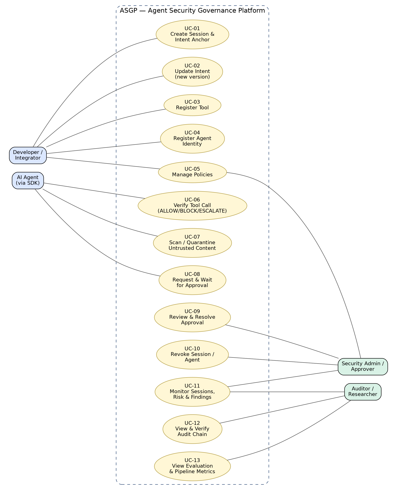

*Figure 1 — Use case diagram of ASGP*

4.1 Use case descriptions

UC-01 Create Session & Intent Anchor

<table>
<colgroup>
<col style="width: 21%" />
<col style="width: 78%" />
</colgroup>
<tbody>
<tr class="odd">
<td><strong>Primary actor</strong></td>
<td>Developer / Integrator</td>
</tr>
<tr class="even">
<td><strong>Preconditions</strong></td>
<td>Backend running.</td>
</tr>
<tr class="odd">
<td><strong>Main flow</strong></td>
<td>
1. Developer submits intent and permissions (allowed/forbidden tools, paths, destinations).

2. System validates input.

3. System creates the session (active, risk 0) and Intent Anchor v1 with canonical hash.

4. System returns the session.
</td>
</tr>
<tr class="even">
<td><strong>Alternative / exceptions</strong></td>
<td>Invalid input → 422 validation error; nothing is stored.</td>
</tr>
<tr class="odd">
<td><strong>Postconditions</strong></td>
<td>Active session with anchor v1 exists.</td>
</tr>
<tr class="even">
<td><strong>Interface</strong></td>
<td>POST /sessions</td>
</tr>
<tr class="odd">
<td><strong>Requirements</strong></td>
<td>FR-01, FR-02</td>
</tr>
</tbody>
</table>

UC-02 Update Intent

<table>
<colgroup>
<col style="width: 21%" />
<col style="width: 78%" />
</colgroup>
<tbody>
<tr class="odd">
<td><strong>Primary actor</strong></td>
<td>Developer / Integrator</td>
</tr>
<tr class="even">
<td><strong>Preconditions</strong></td>
<td>Session exists and is active.</td>
</tr>
<tr class="odd">
<td><strong>Main flow</strong></td>
<td>
1. Developer submits a new intent/permission set.

2. System creates a new anchor version and hash.

3. Later actions are checked against the new version.
</td>
</tr>
<tr class="even">
<td><strong>Alternative / exceptions</strong></td>
<td>Unknown session → 404.</td>
</tr>
<tr class="odd">
<td><strong>Postconditions</strong></td>
<td>New anchor version stored; previous versions retained.</td>
</tr>
<tr class="even">
<td><strong>Interface</strong></td>
<td>PUT /sessions/{id}/intent</td>
</tr>
<tr class="odd">
<td><strong>Requirements</strong></td>
<td>FR-03</td>
</tr>
</tbody>
</table>

UC-03 Register Tool

<table>
<colgroup>
<col style="width: 21%" />
<col style="width: 78%" />
</colgroup>
<tbody>
<tr class="odd">
<td><strong>Primary actor</strong></td>
<td>Developer / Integrator</td>
</tr>
<tr class="even">
<td><strong>Preconditions</strong></td>
<td>—</td>
</tr>
<tr class="odd">
<td><strong>Main flow</strong></td>
<td>
1. Developer provides tool name, description, sensitivity, requires-signature flag.

2. System stores the tool definition.
</td>
</tr>
<tr class="even">
<td><strong>Alternative / exceptions</strong></td>
<td>Invalid sensitivity → 422.</td>
</tr>
<tr class="odd">
<td><strong>Postconditions</strong></td>
<td>Tool is known to the registry; unregistered tools are hard-blocked.</td>
</tr>
<tr class="even">
<td><strong>Interface</strong></td>
<td>POST /tools/register</td>
</tr>
<tr class="odd">
<td><strong>Requirements</strong></td>
<td>FR-06</td>
</tr>
</tbody>
</table>

UC-04 Register Agent Identity

<table>
<colgroup>
<col style="width: 21%" />
<col style="width: 78%" />
</colgroup>
<tbody>
<tr class="odd">
<td><strong>Primary actor</strong></td>
<td>Developer / Integrator</td>
</tr>
<tr class="even">
<td><strong>Preconditions</strong></td>
<td>Agent holds an Ed25519 key pair.</td>
</tr>
<tr class="odd">
<td><strong>Main flow</strong></td>
<td>
1. Developer submits agent name and public key.

2. System stores identity as active.

3. Agent signs later requests; system verifies them.
</td>
</tr>
<tr class="even">
<td><strong>Alternative / exceptions</strong></td>
<td>Admin revokes agent → later requests blocked (AGENT_REVOKED).</td>
</tr>
<tr class="odd">
<td><strong>Postconditions</strong></td>
<td>Agent identity active.</td>
</tr>
<tr class="even">
<td><strong>Interface</strong></td>
<td>POST /agents</td>
</tr>
<tr class="odd">
<td><strong>Requirements</strong></td>
<td>FR-07, FR-08, FR-12</td>
</tr>
</tbody>
</table>

UC-05 Manage Policies

<table>
<colgroup>
<col style="width: 21%" />
<col style="width: 78%" />
</colgroup>
<tbody>
<tr class="odd">
<td><strong>Primary actor</strong></td>
<td>Developer / Security Admin</td>
</tr>
<tr class="even">
<td><strong>Preconditions</strong></td>
<td>—</td>
</tr>
<tr class="odd">
<td><strong>Main flow</strong></td>
<td>
1. Actor submits a structured JSON policy (conditions with allowed operators, effect deny).

2. System validates it (no executable code) and stores it.

3. Policies are evaluated at the policy stage.
</td>
</tr>
<tr class="even">
<td><strong>Alternative / exceptions</strong></td>
<td>Unknown operator / malformed policy → validation error.</td>
</tr>
<tr class="odd">
<td><strong>Postconditions</strong></td>
<td>Policy enabled and enforced deterministically.</td>
</tr>
<tr class="even">
<td><strong>Interface</strong></td>
<td>POST/GET /policies</td>
</tr>
<tr class="odd">
<td><strong>Requirements</strong></td>
<td>FR-09, FR-13</td>
</tr>
</tbody>
</table>

UC-06 Verify Tool Call

<table>
<colgroup>
<col style="width: 21%" />
<col style="width: 78%" />
</colgroup>
<tbody>
<tr class="odd">
<td><strong>Primary actor</strong></td>
<td>AI Agent (via SDK)</td>
</tr>
<tr class="even">
<td><strong>Preconditions</strong></td>
<td>Session active; tool registered.</td>
</tr>
<tr class="odd">
<td><strong>Main flow</strong></td>
<td>
1. Agent calls a protected tool; SDK builds ActionRequest.

2. Gateway runs the pipeline (crypto, policy, intent, injection, behavior, risk).

3. Gateway records decision, findings, risk change, audit event, timings.

4. SDK receives ALLOW → runs the tool once; BLOCK → raises and never runs it; ESCALATE → goes to UC-08.
</td>
</tr>
<tr class="even">
<td><strong>Alternative / exceptions</strong></td>
<td>Any hard failure (unknown/non-active session, unregistered tool, invalid signature, replay, policy violation) → BLOCK. Gateway unreachable → SDK fails closed.</td>
</tr>
<tr class="odd">
<td><strong>Postconditions</strong></td>
<td>Decision and audit event persisted; session risk updated.</td>
</tr>
<tr class="even">
<td><strong>Interface</strong></td>
<td>POST /actions/verify</td>
</tr>
<tr class="odd">
<td><strong>Requirements</strong></td>
<td>FR-10, FR-11, FR-13–FR-18, FR-23, FR-26</td>
</tr>
</tbody>
</table>

UC-07 Scan / Quarantine Untrusted Content

<table>
<colgroup>
<col style="width: 21%" />
<col style="width: 78%" />
</colgroup>
<tbody>
<tr class="odd">
<td><strong>Primary actor</strong></td>
<td>AI Agent (via SDK)</td>
</tr>
<tr class="even">
<td><strong>Preconditions</strong></td>
<td>—</td>
</tr>
<tr class="odd">
<td><strong>Main flow</strong></td>
<td>
1. Agent submits fetched text (email, file, web).

2. Detector scans for injection patterns.

3. System returns clean or quarantined with findings.

4. Agent passes only clean (or labeled) content into its context.
</td>
</tr>
<tr class="even">
<td><strong>Alternative / exceptions</strong></td>
<td>Detector finds patterns in benign quotations → possible false positive (known limitation).</td>
</tr>
<tr class="odd">
<td><strong>Postconditions</strong></td>
<td>Findings stored; disposition returned.</td>
</tr>
<tr class="even">
<td><strong>Interface</strong></td>
<td>POST /content/scan, /content/ingress</td>
</tr>
<tr class="odd">
<td><strong>Requirements</strong></td>
<td>FR-15, FR-22</td>
</tr>
</tbody>
</table>

UC-08 Request & Wait for Approval

<table>
<colgroup>
<col style="width: 21%" />
<col style="width: 78%" />
</colgroup>
<tbody>
<tr class="odd">
<td><strong>Primary actor</strong></td>
<td>AI Agent (via SDK)</td>
</tr>
<tr class="even">
<td><strong>Preconditions</strong></td>
<td>Decision was ESCALATE.</td>
</tr>
<tr class="odd">
<td><strong>Main flow</strong></td>
<td>
1. System creates approval bound to the action digest with expiry.

2. SDK polls the approval status.

3. When approved, SDK consumes the approval and runs the tool once.
</td>
</tr>
<tr class="even">
<td><strong>Alternative / exceptions</strong></td>
<td>Rejected or expired → SDK raises; tool never runs. Digest mismatch (changed parameters) → new decision needed.</td>
</tr>
<tr class="odd">
<td><strong>Postconditions</strong></td>
<td>Approval consumed (single use) or closed.</td>
</tr>
<tr class="even">
<td><strong>Interface</strong></td>
<td>GET /approvals/{id}, POST …/consume</td>
</tr>
<tr class="odd">
<td><strong>Requirements</strong></td>
<td>FR-19, FR-21</td>
</tr>
</tbody>
</table>

UC-09 Review & Resolve Approval

<table>
<colgroup>
<col style="width: 21%" />
<col style="width: 78%" />
</colgroup>
<tbody>
<tr class="odd">
<td><strong>Primary actor</strong></td>
<td>Security Admin</td>
</tr>
<tr class="even">
<td><strong>Preconditions</strong></td>
<td>At least one pending approval.</td>
</tr>
<tr class="odd">
<td><strong>Main flow</strong></td>
<td>
1. Admin opens Approvals queue.

2. Admin reviews tool, session, action id, expiry.

3. Admin chooses Approve once or Reject.

4. System updates approval status.
</td>
</tr>
<tr class="even">
<td><strong>Alternative / exceptions</strong></td>
<td>Approval expired → cannot be approved.</td>
</tr>
<tr class="odd">
<td><strong>Postconditions</strong></td>
<td>Approval is approved or rejected.</td>
</tr>
<tr class="even">
<td><strong>Interface</strong></td>
<td>GET /approvals, POST /approvals/{id}/resolve</td>
</tr>
<tr class="odd">
<td><strong>Requirements</strong></td>
<td>FR-20, FR-27</td>
</tr>
</tbody>
</table>

UC-10 Revoke Session / Agent

<table>
<colgroup>
<col style="width: 21%" />
<col style="width: 78%" />
</colgroup>
<tbody>
<tr class="odd">
<td><strong>Primary actor</strong></td>
<td>Security Admin</td>
</tr>
<tr class="even">
<td><strong>Preconditions</strong></td>
<td>Session or agent exists.</td>
</tr>
<tr class="odd">
<td><strong>Main flow</strong></td>
<td>
1. Admin requests revocation.

2. System sets status to revoked.

3. All later requests are blocked.
</td>
</tr>
<tr class="even">
<td><strong>Alternative / exceptions</strong></td>
<td>Unknown id → 404.</td>
</tr>
<tr class="odd">
<td><strong>Postconditions</strong></td>
<td>Session/agent revoked.</td>
</tr>
<tr class="even">
<td><strong>Interface</strong></td>
<td>POST /sessions/{id}/revoke, /agents/{id}/revoke</td>
</tr>
<tr class="odd">
<td><strong>Requirements</strong></td>
<td>FR-05, FR-08</td>
</tr>
</tbody>
</table>

UC-11 Monitor Sessions, Risk & Findings

<table>
<colgroup>
<col style="width: 21%" />
<col style="width: 78%" />
</colgroup>
<tbody>
<tr class="odd">
<td><strong>Primary actor</strong></td>
<td>Security Admin / Auditor</td>
</tr>
<tr class="even">
<td><strong>Preconditions</strong></td>
<td>Dashboard and backend running.</td>
</tr>
<tr class="odd">
<td><strong>Main flow</strong></td>
<td>
1. Actor opens Command Center or Sessions view.

2. Dashboard shows sessions, risk history, decision stream, findings.

3. Actor opens an event drawer for explanation and technical trace.
</td>
</tr>
<tr class="even">
<td><strong>Alternative / exceptions</strong></td>
<td>Gateway unavailable → dashboard shows fail-closed state.</td>
</tr>
<tr class="odd">
<td><strong>Postconditions</strong></td>
<td>—</td>
</tr>
<tr class="even">
<td><strong>Interface</strong></td>
<td>GET /sessions, /risk/{id}, /findings/{id}</td>
</tr>
<tr class="odd">
<td><strong>Requirements</strong></td>
<td>FR-04, FR-17, FR-25, FR-27, FR-28</td>
</tr>
</tbody>
</table>

UC-12 View & Verify Audit Chain

<table>
<colgroup>
<col style="width: 21%" />
<col style="width: 78%" />
</colgroup>
<tbody>
<tr class="odd">
<td><strong>Primary actor</strong></td>
<td>Auditor / Security Admin</td>
</tr>
<tr class="even">
<td><strong>Preconditions</strong></td>
<td>Session has audit events.</td>
</tr>
<tr class="odd">
<td><strong>Main flow</strong></td>
<td>
1. Actor lists audit events.

2. Actor requests chain verification.

3. System recomputes hashes and compares with the audit head.

4. Dashboard shows Verified or Needs attention.
</td>
</tr>
<tr class="even">
<td><strong>Alternative / exceptions</strong></td>
<td>Modified or missing entry → valid=false with an error list.</td>
</tr>
<tr class="odd">
<td><strong>Postconditions</strong></td>
<td>—</td>
</tr>
<tr class="even">
<td><strong>Interface</strong></td>
<td>GET /audit/{id}, POST /audit/{id}/verify</td>
</tr>
<tr class="odd">
<td><strong>Requirements</strong></td>
<td>FR-23, FR-24</td>
</tr>
</tbody>
</table>

UC-13 View Evaluation & Pipeline Metrics

<table>
<colgroup>
<col style="width: 21%" />
<col style="width: 78%" />
</colgroup>
<tbody>
<tr class="odd">
<td><strong>Primary actor</strong></td>
<td>Auditor / Researcher</td>
</tr>
<tr class="even">
<td><strong>Preconditions</strong></td>
<td>Evaluation report generated.</td>
</tr>
<tr class="odd">
<td><strong>Main flow</strong></td>
<td>
1. Actor opens the Research view.

2. Dashboard shows confusion matrix, F1, ablation, latency, and known failures.
</td>
</tr>
<tr class="even">
<td><strong>Alternative / exceptions</strong></td>
<td>Report missing → hint to run python -m demo.evaluate.</td>
</tr>
<tr class="odd">
<td><strong>Postconditions</strong></td>
<td>—</td>
</tr>
<tr class="even">
<td><strong>Interface</strong></td>
<td>GET /metrics/pipeline; evaluation-results.json</td>
</tr>
<tr class="odd">
<td><strong>Requirements</strong></td>
<td>FR-26, FR-29</td>
</tr>
</tbody>
</table>

5\. Architecture

5.1 Level 0 — System context

ASGP is treated as one system. Around it are the user/developer, the integrated agent, the protected tools, the human approver, the optional AI provider, and untrusted content sources.

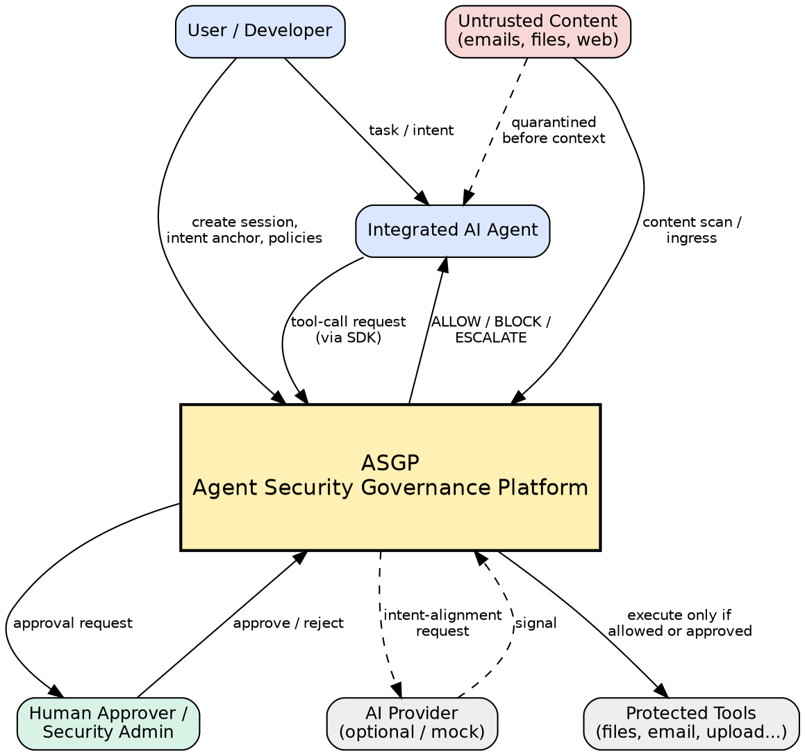

*Figure 2 — Architecture Level 0: system context*

5.2 Level 1 — Containers and components

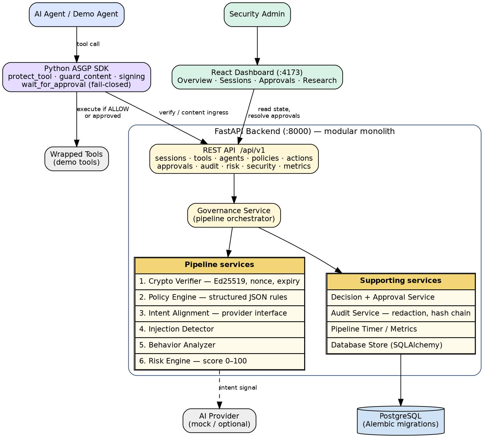

*Figure 3 — Architecture Level 1: containers and backend components*

| **Component**                               | **Responsibility**                                                                                                                         |
|---------------------------------------------|--------------------------------------------------------------------------------------------------------------------------------------------|
| **Python SDK**                              | Wraps registered tools, builds canonical requests, signs them, calls the gateway, polls/consumes approvals, and fails closed.              |
| **REST API (FastAPI)**                      | Exposes /api/v1 endpoints for sessions, tools, agents, policies, actions, approvals, audit, risk, security, metrics, health.               |
| **Governance Service**                      | Orchestrates the verification pipeline and records the result.                                                                             |
| **Crypto Verifier**                         | Ed25519 signature, nonce/replay, expiry, scope, and intent-anchor checks.                                                                  |
| **Policy Engine**                           | Deterministic tool, path, destination, and structured-policy enforcement.                                                                  |
| **Intent Alignment / Injection / Behavior** | Independent signals that produce findings with severity, confidence, and risk delta.                                                       |
| **Risk Engine**                             | Bounded 0–100 score; thresholds ESCALATE ≥ 40, BLOCK ≥ 70; sensitivity deltas low −5, medium +40, high +70, critical +100; hard block +20. |
| **Decision & Approval Service**             | Final outcome with reason codes; approval creation, resolution, consumption, expiry.                                                       |
| **Audit Service**                           | Redaction, per-session hash chain, chain verification.                                                                                     |
| **Metrics / Timer**                         | Per-stage and total latency.                                                                                                               |
| **PostgreSQL**                              | Source of truth; migrations with Alembic.                                                                                                  |
| **React Dashboard**                         | Command Center, Sessions, Approvals, Research views.                                                                                       |

6\. Data model (ERD)

Generated from backend/app/db/models.py. Solid lines are database foreign keys; dashed lines are logical relationships (stored as plain identifiers).

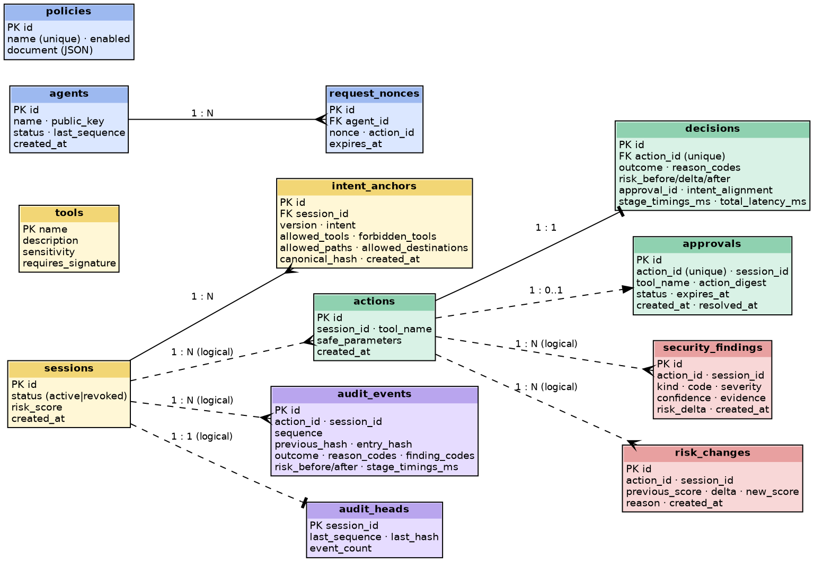

*Figure 4 — Entity-relationship diagram*

| **Table**                            | **Purpose**                                                                      |
|--------------------------------------|----------------------------------------------------------------------------------|
| **sessions / intent_anchors**        | Session lifecycle and versioned intent with permission lists and canonical hash. |
| **tools / agents / request_nonces**  | Tool registry, agent identities and public keys, replay-protection nonces.       |
| **policies**                         | Validated structured JSON policy documents.                                      |
| **actions / decisions**              | Exact normalized request (redacted parameters) and its single decision.          |
| **approvals**                        | Action-digest-bound human approval with status and expiry.                       |
| **security_findings / risk_changes** | Explainable evidence and score transitions.                                      |
| **audit_events / audit_heads**       | Hash-chained audit log and the per-session chain head.                           |

7\. Behavioral diagrams

7.1 Activity diagram — security pipeline

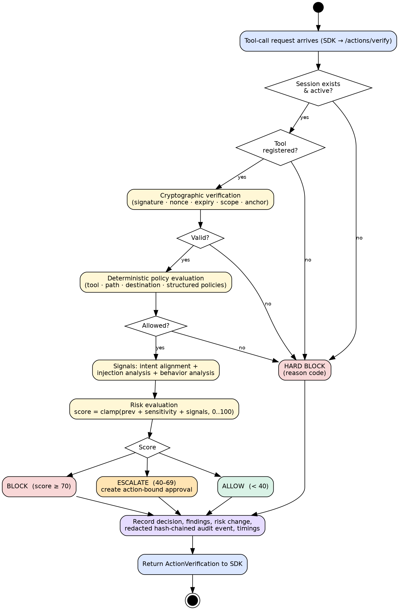

*Figure 5 — Verification pipeline (activity diagram)*

Risk thresholds

| **Resulting score**      | **Outcome** | **Reason code**                                                                                                                            |
|--------------------------|-------------|--------------------------------------------------------------------------------------------------------------------------------------------|
| **\< 40**                | ALLOW       | RISK_ACCEPTABLE (or policy code, e.g. TOOL_ALLOWED)                                                                                        |
| **40 – 69**              | ESCALATE    | RISK_THRESHOLD_ESCALATE                                                                                                                    |
| **≥ 70**                 | BLOCK       | RISK_THRESHOLD_BLOCK                                                                                                                       |
| **Hard control failure** | BLOCK       | e.g. UNKNOWN_SESSION, SESSION_NOT_ACTIVE, UNREGISTERED_TOOL, INVALID_SIGNATURE, REPLAY_DETECTED, TOOL_OUTSIDE_SCOPE, PATH_OUTSIDE_BOUNDARY |

7.2 Sequence diagrams

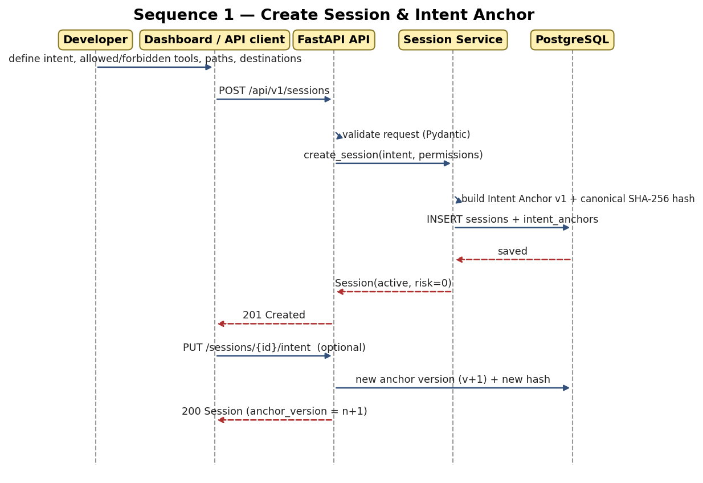

*Figure 6 — Create session and intent anchor*

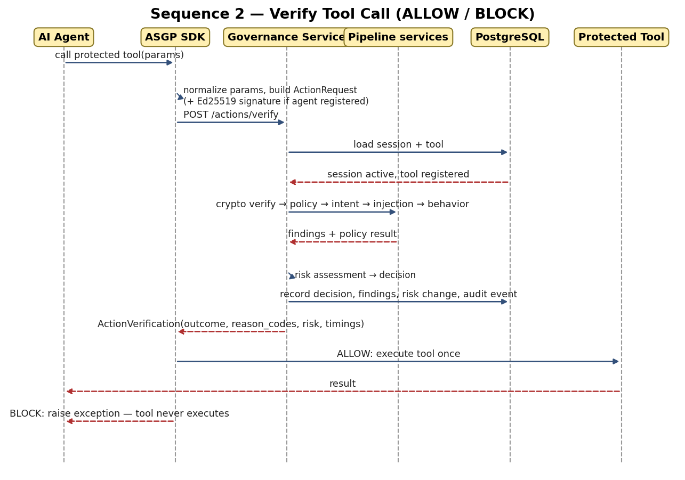

*Figure 7 — Verify tool call (ALLOW / BLOCK)*

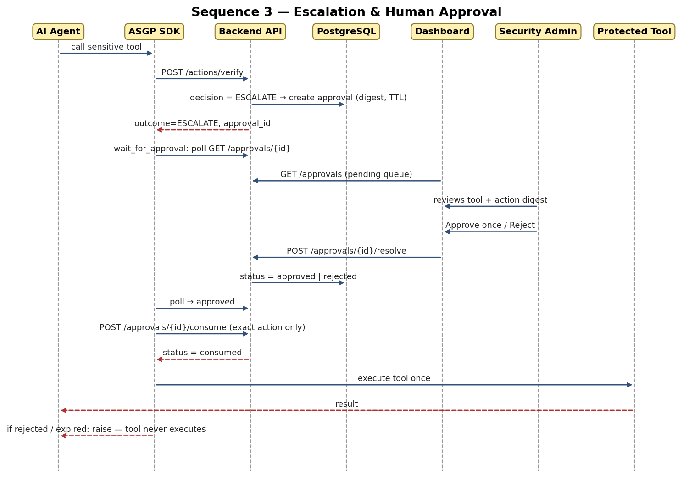

*Figure 8 — Escalation and human approval*

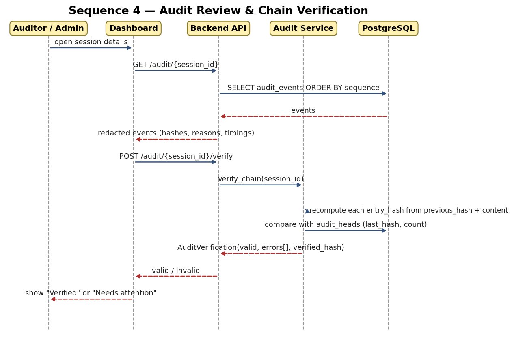

*Figure 9 — Audit review and chain verification*

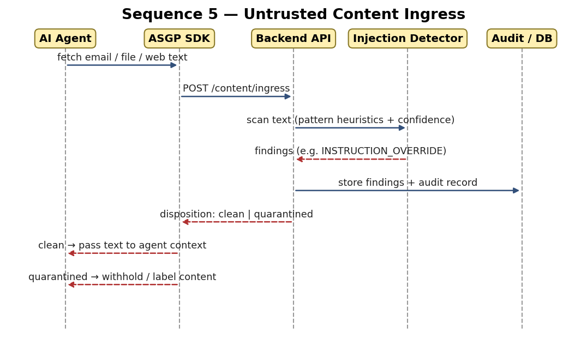

*Figure 10 — Untrusted content ingress*

7.3 State diagrams

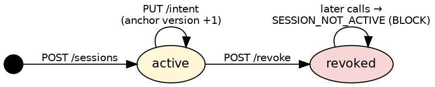

*Figure 11 — Session lifecycle (agents follow the same active → revoked states)*

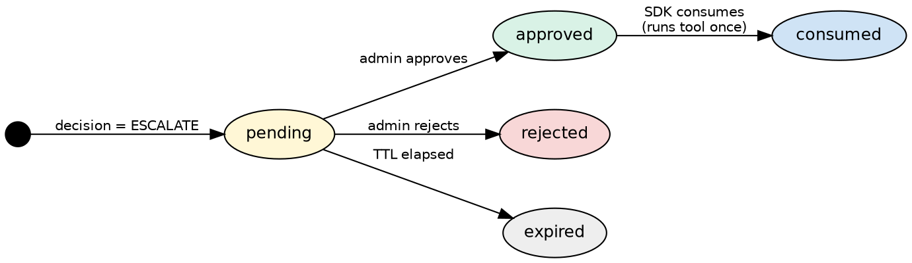

*Figure 12 — Approval lifecycle*

8\. Deployment diagram

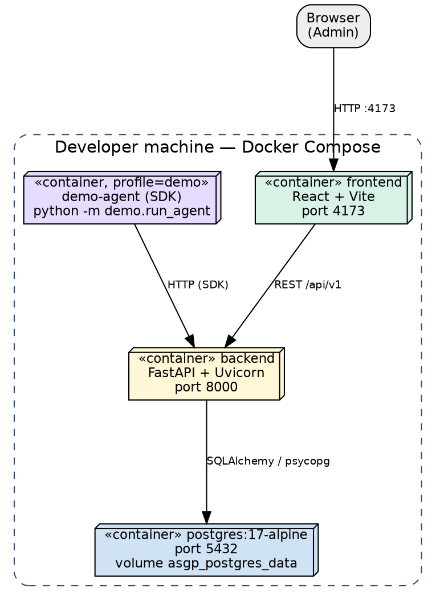

*Figure 13 — Docker Compose deployment (from compose.yaml)*

The demo-agent container runs only with the “demo” profile. Database credentials in compose.yaml are development defaults and must be changed for any shared environment.

9\. Traceability matrix

| **Use case** | **Functional requirements**             | **Main endpoint(s) / component**           |
|--------------|-----------------------------------------|--------------------------------------------|
| **UC-01**    | FR-01, FR-02, FR-04                     | POST /sessions                             |
| **UC-02**    | FR-03                                   | PUT /sessions/{id}/intent                  |
| **UC-03**    | FR-06                                   | POST /tools/register                       |
| **UC-04**    | FR-07, FR-08, FR-12                     | POST /agents                               |
| **UC-05**    | FR-09, FR-13                            | POST/GET /policies                         |
| **UC-06**    | FR-10, FR-11, FR-13–FR-18, FR-23, FR-26 | POST /actions/verify; Governance Service   |
| **UC-07**    | FR-15, FR-22                            | POST /content/scan, /content/ingress       |
| **UC-08**    | FR-19, FR-21                            | Approvals; SDK wait_for_approval           |
| **UC-09**    | FR-20, FR-27                            | POST /approvals/{id}/resolve; dashboard    |
| **UC-10**    | FR-05, FR-08                            | POST /…/revoke                             |
| **UC-11**    | FR-04, FR-17, FR-25, FR-27, FR-28       | GET /sessions, /risk, /findings; dashboard |
| **UC-12**    | FR-23, FR-24                            | GET/POST /audit/{id}                       |
| **UC-13**    | FR-26, FR-29                            | GET /metrics/pipeline; evaluation report   |

10\. Open points for the team

- Confirm the proposed NFR targets (e.g. P95 latency) and priorities (M/S/C) in Section 2.

- Decide the exact actor list your supervisor expects (Admin and Auditor can be merged).

- Check each use case flow against the live system once; descriptions were derived from code and docs, not from a full manual run.

- Policy effect currently supports “deny” only; confirm that this matches your intended scope before presenting.

- Review the known false positive (benign quotation of attack language) and decide how it will be presented in the defense.

- Dashboard has four views; there is no policy-management UI — policies are managed through the API.
